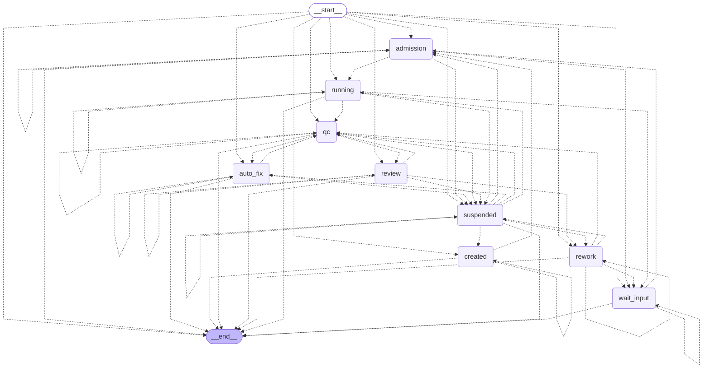
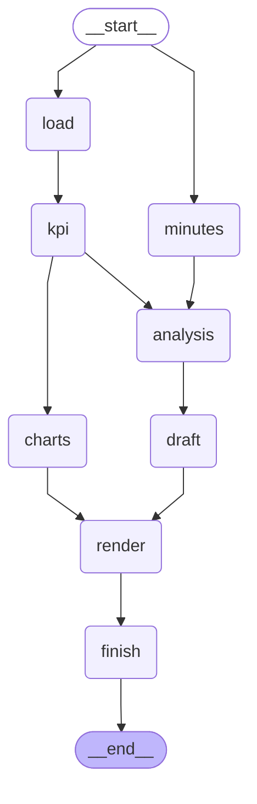
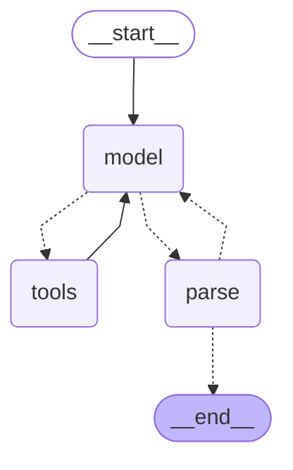

# LangGraph 编排图

由 `uv run mini graph` 生成。任务编排图的边由状态流转表推出（`workflow.exits()`），与状态机一一对应；步骤图的边来自 `employee.yaml` 中步骤的 `after`。实线为固定边，虚线为条件边。

## 任务编排图

## 步骤图（running / rework 节点内部，按 employee.yaml 中步骤的 after 构建，同一层的步骤并行执行）

## 模型步骤子图

