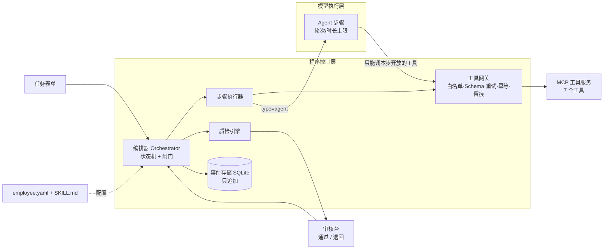

# 迷你数字员工 · 技术报告

> 场景 A：经营周报员工。代码仓库：https://github.com/wkxz/Digital-Employees　在线体验：https://mini.wkxyz.xyz

## 1. 需求理解与验收标准

业务方要的是“一份区域经理拿来就能用的周报”，而不是一段聊天回复。我们把它拆成可程序判定的验收标准：

| 业务要求 | 验收标准（程序可判定） |
|----|----------------|
| 数字准确 | 正文所有数字来自程序计算（占位符引用），正文与表格一致，各区域之和 = 合计 |
| 异常有原因 | 每条异常都有原因，原因引用周会纪要条目编号，纪要未提及的写“原因待核实”，不推测；未上传纪要时暂停待补，发起人明确确认“本周没有周会纪要”后才照常生成（原因全部标注待核实，确认人记入事件日志） |
| 结构完整、可直接使用 | 六个固定章节 + 附录，至少 2 张图、核心指标表和区域表 |
| 审核意见被采纳 | 退回前先用数据核对意见本身（点名的区域 / 门店不在异常清单、认不出的名称、要求写配置禁止的内容、相关纪要已全部引用），可能有误时提示审核人确认，不消耗返工次数；意见拆成待办（章节 + 关键词），重做后逐条校验，不通过不能再次送审；员工可说明某条意见不适用，程序以核实结果为准放行并告知审核人，无法核实的转审核人更正或撤回意见；要求说清某区域 / 门店原因的，定位到具体异常条目和纪要相关条目，须新引用尚未引用的相关条目，只换说法不算采纳 |
| 缺材料 / 故障时不编造 | 暂停并说明“哪一步、什么原因、已完成 x/y 步”，补充或恢复后从断点继续；新开门店、新上市商品在主数据里找不到时暂停请补主数据，不悄悄剔除少算 |

待企业确认的口径见 README“待企业确认的问题”。

## 2. 架构



- 程序控制层持有任务状态，决定下一步、执行质检和闸门；模型只在 agent 步骤内被调用，不能触发任何状态流转。
- 编排基于 LangGraph：任务推进是一张 StateGraph，节点是各状态的处理函数，边由状态流转表推出（路由返回表外节点会直接报错）；待补材料、暂停转人工、待审核三个节点用 `interrupt()` 暂停，人工操作先经 `Store.transition()` 改状态，再用 `Command(resume)` 唤醒图。执行 / 返工节点内部是一张步骤图：每个工作步骤一个节点，按配置中的 `after` 连线，没有依赖关系的步骤并行执行，失败的步骤只记下原因，由汇合节点在同批并行步骤结束后统一暂停；每个程序步骤的输入哈希只覆盖它和上游步骤用到的表单字段，补充销售明细时不会重做只依赖周会纪要的步骤。每个 agent 步骤是一张“模型 → 工具 / 校验 → 模型”子图，轮次与时长上限、输出 Schema 校验都在子图内由程序判定。SQLite 任务表是唯一的状态来源，LangGraph 检查点只记录图停在哪个节点。流程图见 `docs/workflow.md`。
- 多模型协作（复核员）：质检前由另一个模型（可在 `model.reviewer` 或 `MINI_REVIEW_*` 中单独配置）逐条核对引用了纪要的异常原因是否被纪要原文支持，结论交给质检规则 `cause_review`（默认 warning 提示审核人，可改为 blocking 进入自动修正）；按“原因 + 纪要原文”哈希缓存，复核员不可用时不阻塞任务。
- 跨周长期记忆：用 LangGraph Store（SqliteStore）按“员工 + 统计周期”记住已交付周报的下周关注事项、异常与原因摘要、纪要行动项；下一周撰写时作为 `last_week` 交给模型，岗位说明要求跟进仍需关注的事项、不照抄不推测。只记录审核通过的版本。
- 实时进度：图以流式方式运行（含子图），正在运行的节点、模型边生成边输出的内容（模型接口用流式调用）按步骤节流写入 SQLite 的实时进度表；执行任务的是独立子进程，网页进程读出变化后经 SSE 推给浏览器，断线自动续传，连不上时退回定时刷新。
- 所有数字由 `compute_kpis` 算出，模型写作时只能用占位符（如 `{{region.华东.sales_wow}}`）引用，渲染时替换为真实数值，从机制上杜绝写错数字。

## 3. 状态流转表

共 12 个状态。所有流转由 `Store.transition()` 一个入口完成：查表 → 校验触发方 → 执行闸门 → 乐观锁更新 → 写事件。
表外的流转、触发方不对、闸门不满足的操作一律拒绝并写入 `transition_rejected` 事件，状态不变。

| 当前状态 | 事件 | 闸门条件（程序判定） | 目标状态 | 触发方 |
|----|-----|----------|-----|--|
| 已创建 CREATED | submit | 表单 Schema 校验通过 | 准入校验 ADMISSION | 系统 |
| 已创建 CREATED | form_invalid | 表单字段缺失或格式错误（如周期在未来、文件类型不支持） | 已拒绝 REJECTED | 系统 |
| 准入校验 ADMISSION | admission_pass | 必需文件齐全，列、周次覆盖、数据质量合格 | 执行中 RUNNING | 系统 |
| 准入校验 ADMISSION | admission_missing | 缺文件 / 缺列 / 缺上周数据 / 主数据找不到本周或上周有销售的门店、商品编码 / 缺当周销售目标（记录缺什么） | 待补材料 WAITING_INPUT | 系统 |
| 准入校验 ADMISSION | admission_invalid | 输入不合规（含个人隐私等） | 已拒绝 REJECTED | 系统 |
| 准入校验 ADMISSION | step_failed | 校验用的工具重试耗尽（保留断点） | 暂停转人工 SUSPENDED | 系统 |
| 待补材料 WAITING_INPUT | supplement | 发起人上传补充材料，重新准入 | 准入校验 ADMISSION | 发起人 |
| 执行中 RUNNING | steps_done | 全部步骤完成 | 自动质检 QC | 系统 |
| 执行中 RUNNING | step_missing_input | 执行中发现缺材料（保留断点） | 待补材料 WAITING_INPUT | 系统 |
| 执行中 RUNNING | step_failed | 工具重试耗尽 / 超轮次 / 超时（保留断点） | 暂停转人工 SUSPENDED | 系统 |
| 自动质检 QC | qc_pass | 检验记录中全部 blocking 规则通过 | 待审核 PENDING_REVIEW | 系统 |
| 自动质检 QC | qc_fail | 有 blocking 规则不通过，修正次数 < 上限 | 自动修正 AUTO_FIXING | 系统 |
| 自动质检 QC | qc_fail_exhausted | 修正次数 ≥ 上限，转人工 | 暂停转人工 SUSPENDED | 系统 |
| 自动质检 QC | step_failed | 质检程序异常（保留断点） | 暂停转人工 SUSPENDED | 系统 |
| 自动质检 QC | feedback_disputed | 员工说明审核意见不适用、程序无法核实，模型修正解决不了，转审核人确认 | 暂停转人工 SUSPENDED | 系统 |
| 自动修正 AUTO_FIXING | fix_done | 修正后重新质检 | 自动质检 QC | 系统 |
| 自动修正 AUTO_FIXING | step_failed | 修正过程中工具/模型失败或超限 | 暂停转人工 SUSPENDED | 系统 |
| 待审核 PENDING_REVIEW | approve | 审核人通过，且审核版本 = 交付版本、质检通过 | 已交付 DELIVERED | 审核人 |
| 待审核 PENDING_REVIEW | request_changes | 审核人退回，意见非空，返工次数 < 上限 | 返工中 REWORK | 审核人 |
| 待审核 PENDING_REVIEW | request_changes_exhausted | 返工次数已达上限，转线下沟通 | 暂停转人工 SUSPENDED | 审核人 |
| 返工中 REWORK | rework_done | 按意见重做完成，新版本重新质检 | 自动质检 QC | 系统 |
| 返工中 REWORK | step_missing_input | 重做中发现缺材料（保留断点） | 待补材料 WAITING_INPUT | 系统 |
| 返工中 REWORK | step_failed | 重做中工具/模型失败或超限（保留断点） | 暂停转人工 SUSPENDED | 系统 |
| 暂停转人工 SUSPENDED | retry | 人工确认后从断点继续（回到暂停前的状态与步骤） | 暂停前的状态（断点） | 发起人 / 审核人 |
| 暂停转人工 SUSPENDED | revise_feedback | 因审核意见无法落实而暂停：审核人更正意见，按新意见重做（不计返工次数，原意见留痕；不能是发起人本人） | 返工中 REWORK | 审核人 |
| 暂停转人工 SUSPENDED | withdraw_feedback | 因审核意见无法落实而暂停：审核人撤回意见，当前版本重新质检 | 自动质检 QC | 审核人 |
| 暂停转人工 SUSPENDED | manual_recheck | 人工补充/修改后重新质检（仍须质检通过才能送审） | 自动质检 QC | 发起人 / 审核人 |
| 待审核 PENDING_REVIEW | manual_recheck | 审核前人工在网页上修改报告，新版本重新质检（只做程序修正，不让模型改写人工内容） | 自动质检 QC | 发起人 / 审核人 |
| 任一非终态 | cancel | — | 已取消 CANCELLED | 发起人 |

关键控制点：
- **能否送审**：只有 `QC → PENDING_REVIEW` 一条路，闸门读取质检引擎写入的检验记录。
- **能否交付**：只有审核人在 `PENDING_REVIEW` 执行 approve，且审核时看到的文件哈希 = 交付文件哈希、质检通过。
- **暂停可恢复**：进入暂停时记录断点（`resume_to`），重试回到原状态与原步骤；修正超限后人工可修改内容再“重新质检”，仍须质检通过才能送审。

## 4. 员工能力配置

| 文件 | 内容 | 谁改 |
|---|------------|---|
| `employee.yaml` | 表单字段、准入规则与列名别名、分析口径、开放工具、工作步骤、质检规则、上限、报告章节与交付格式 | 业务人员 / 管理员 |
| `SKILL.md` | 岗位职责、异常分析方法、各章节写作要求、注意事项（Agent Skills 格式，按小节注入对应步骤） | 业务人员 |
| `master.xlsx` | 兜底主数据：门店信息、商品信息、销售目标（明细只有编码时按 `data.lookups` 关联）。按工作表取用，优先级：表单“主数据”上传的文件 > 销售明细 xlsx 中的同名工作表 > 本文件 | 业务人员 |

场景 A 的数据结构（多工作表、编码关联、记录 ID、销售目标）全部写在 `employee.yaml` 的 `data` 段，换一家企业的数据只改配置。

配置权限与留痕：只有管理员（口令为 `.env` 的 `MINI_ADMIN_PASSWORD`，未设置时只读）能在界面保存配置和全局故障注入；每次保存记录修改人、时间、改前改后全文（`tasks.db` 的 `config_changes` 表），可看差异、一键回退，直接改文件也会在下次发起任务时被发现并记一笔；任务发起时把员工配置复制到任务目录，整个任务按这份执行，改配置只影响之后新建的任务（重试时可选“使用最新配置”）；发起人不能审核自己发起的任务（状态机闸门判定）。

工作步骤（7 步）：读取销售明细 → 计算指标与识别异常 → 读取周会纪要 → 生成图表（以上为程序直接调用工具）→ 异常原因分析 → 撰写周报（模型）→ 生成交付文件。
上限：每步 8 轮 / 180 秒，任务 600 秒，工具重试 3 次，质检修正 2 轮，返工 3 次；取值理由见 README。

## 5. 工具

| 工具 | 用途 | 调用方 | 副作用 |
|---|------|---|---|
| read_sales_data | 读取、识别列名别名、清洗 | 程序 | 写清洗后数据 |
| compute_kpis | KPI、环比、异常识别 | 程序 | 写 kpis.json |
| read_minutes | 读取纪要并按条编号 | 程序 | 写 minutes.json |
| search_minutes | 按关键词检索纪要条目 | 模型（异常分析） | 只读 |
| query_kpi | 查询 KPI 与占位符键 | 模型（分析、撰写、修正） | 只读 |
| render_charts | 生成图表 | 程序 | 写文件（幂等） |
| generate_report | 渲染 Word / Markdown | 程序 | 写文件（幂等） |

工具以 FastMCP 实现，入参 / 出参为 JSON Schema。网关只把本步骤开放的工具 Schema 发给模型；越权调用返回“无权限”并写 `tool_denied` 事件。
错误分四类：可重试（指数退避重试 3 次，耗尽后暂停）、缺材料（转待补材料）、参数错（返回模型自行纠正，计入轮次）、不合规（拒绝）。

## 6. 自动质检

| 规则 | 检查内容 | 级别 | 修正方式 |
|---|----------|--|-----|
| 结构完整 | 章节齐全、图表 ≥ 2、必需表格 | blocking | 模型补全 |
| 数据一致性 | 占位符可解析；无硬编码数字；涨跌用词与环比正负一致；区域之和 = 合计 | blocking | 数字能对上的由程序换成占位符；方向词由模型改写 |
| 异常归因有据 | 每条异常有原因；引用的纪要条目存在；无引用时须标“待核实” | blocking | 模型补充或改为待核实；不存在的异常条目由程序删除 |
| 敏感信息 | 手机号、身份证号、敏感词 | blocking | 程序脱敏 |
| 纪要说法与数据核对 | 纪要中的销售涨跌说法（含“暴跌50%”“波动均在±2%以内”等口语、非异常对象的说法）与交易数据不一致时，报告须有“数据核对”说明 | blocking | 说明由程序按交易数据生成并写入报告 |
| 阈值覆盖 | 环比超过 ±10% 的区域、门店全部出现在异常章节（含作为带动门店、按店型合并） | blocking | 程序补回遗漏条目 |
| 篇幅 | Word 正文不超过 3 页（按版面估算，已用 Word 实际分页校准） | blocking | 模型按目标字数压缩，程序先给出各章字数 |
| 字数 | 摘要字数与条数、下周关注条数、全文字数 | warning | 记录，供审核人参考 |
| 审核意见已采纳 | 退回后自动启用，逐条校验待办；原因类意见核对对应异常的原因是否补充了新的纪要依据（相关条目已全部引用时须改写原因，并给审核人说明“纪要中没有更多依据”）；同一意见再次提出时记录第几次 | blocking | 模型补充 |

检验记录（`qc_report.json` + 可读的 `质检记录.md`）记录每轮时间、各规则结果、失败详情和修正动作，随交付包保存。
新增规则：纯配置（`keyword_required`、`regex_forbidden`）或在 `qc/rules.py` 注册一个函数。

## 7. 事件流与断点恢复（加分项）

- 事件类型：task_created、form_validated、state_changed、transition_rejected、admission_checked、step_started / completed / skipped、
  model_called（轮次、耗时、token、工具调用）、model_output_invalid、tool_called / failed / denied、qc_run、review_submitted、feedback_parsed、delivered、task_resumed、error。
- 每步输出落盘，`step_completed` 记录文件哈希与输入哈希；重启后 `mini resume` 扫描未完成任务，跳过已完成且哈希一致的步骤，从第一个未完成步骤继续。
  模型步骤的输出也已落盘，因此恢复后的结果与一次跑完一致（用例 C01 自动比对）。
- 补充材料改变输入哈希，依赖旧输入的步骤会自动重做。
- LangGraph 检查点（`graph_checkpoints.sqlite`）记录图停在哪个节点；检查点丢失或与任务表不一致时，图从 START 按任务表中的状态重新路由，节点依赖上述落盘结果，重复执行不会重复调用模型或重复写文件。
- 工程加固：写文件工具带幂等键（相同输入直接返回已有文件，先写临时文件再原子重命名）；状态更新带乐观锁；文件路径限定在任务目录内。

## 8. 测试

41 条自测用例 + 单元测试与现场变更预演（共 192 项），`make test` 一键运行，`make cases` 输出报告 `reports/case_report.md`（Mock 模型 41/41）；真实模型结果见 `reports/case_report_real.md`。

| 类别 | 数量 | 覆盖 |
|--|--|-----------|
| 官方数据 | 8 | A01–A05 对应公开样例 A-01～A-05（实收、毛利率、外卖占比、目标达成率、前 5 名单品、重复上传、退货、缺数门店日、纪要“基本持平”与数据不符、统计周期超出数据范围）；A01C 只上传 CSV；A06 纪要周次不一致；A07 只传 CSV + 上传只含销售目标的主数据 |
| 正常 | 5 | 赛题场景 1（退回采纳）、CSV + Markdown、涨跌写反自动修正、硬编码数字修正、多条意见 |
| 边界 | 5 | 无异常周、列名别名、跨年周、少量脏数据、中文周期格式 |
| 缺材料 | 7 | 缺纪要（暂停 → 补充后继续；或发起人确认本周没有纪要 → 照常生成、原因标注待核实）、缺上周、缺列、执行中发现数据不完整、纪要为空、脏数据过多（缺销售明细见 A03） |
| 不合规 | 3 | 含手机号、PDF、周期格式错误（统计周期超出数据范围见 A05） |
| 审核流转 | 4 | 非法流转 / 越权审核 / 过期版本审核、返工超限、取消、越权工具调用 |
| 故障 | 8 | 赛题场景 2（检索服务不可用 → 暂停 → 从失败步骤继续）、重试后成功、模型断网、模型循环调用、修正超限、准入期工具故障、输出格式错误 |
| 断点恢复 | 1 | 赛题场景 3：执行中强制结束进程，重启后继续，结果与一次跑完一致 |

另有自测数据 B（`data/test_b/`，12 条手测用例）：按场景 A 结构生成第 41–50 周数据，覆盖新店开业、全周闭店、重新开业、整天重复上传、系统故障缺数、大额退货、纪要与数据不一致、无纪要、多文件、只传 CSV 缺主数据等，并为每条用例配有效与有误两类审核退回意见；判定要点数字由独立脚本按格式要求口径计算。

### 真实模型验证

- deepseek-flash 跑全部 34 条非 Mock 专用用例（2026-11-10，最新代码），34/34 通过，约 58 万 token；一份周报（无返工）约 1.4 万～1.7 万 token、模型耗时约 20～30 秒；各版本首次质检约 3/4 直接通过，其余主要由程序直接修正，全程模型修正调用 4 次。
- 公开样例 A-01～A-05 用真实模型导出到 `deliverables/`（约 9.5 万 token），A-01 含一次审核退回与重做。
- 官方数据 A01～A04 用 deepseek-flash 与 gemini-3.8-flash-high 各跑 3 轮对比：修正程序问题后两者均全部通过、Word 均为 3 页；
  deepseek 更快、输出 token 更少，原因归属更谨慎；gemini 有把纪要中的相关事实直接写成下滑原因的倾向。默认使用 deepseek-flash。
- 验证中发现的问题都改为由程序确定地处理：带动门店补编码与漏写补齐、涨跌词检查扩展、重复单位合并、页数估算按 56 份 Word 实测校准。
- 详见 `reports/real_model_report.md`。

## 9. 复现步骤

```bash
git clone <仓库> && cd mini-employee
make install && make test
make web                      # 新版控制台 http://127.0.0.1:8600；或 make ui（Streamlit）/ make demo
make samples                  # 公开样例 A-01～A-05 → deliverables/（用 .env 中的模型）
```

线上部署：Docker 容器（只监听本机端口）+ Caddy 反向代理 + Cloudflare，地址 https://mini.wkxyz.xyz。
